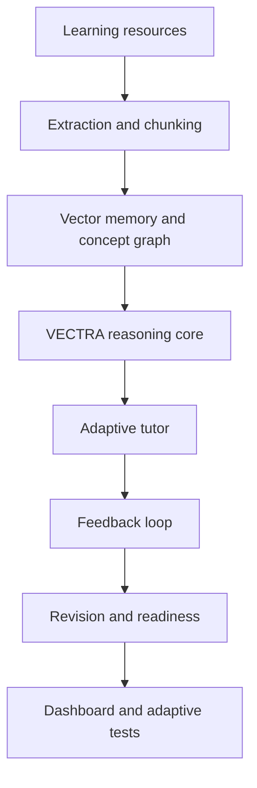

# VECTRA backend

VECTRA is a proposed Vector-Enhanced Cognitive Tutoring & Reasoning Architecture research framework; its analytics scores are transparent project metrics, not validated predictions of hiring outcomes.

## Run

```bash
cp .env.example .env
docker compose up --build
```

The API is at `http://localhost:8000`; Swagger and the complete frontend-facing API contract are generated at `/docs` and `/openapi.json`.

## Key API contract

All protected routes use `Authorization: Bearer <access_token>`. Register/login return access and refresh tokens. Admin-only routes are document upload/delete, concept creation/relationships, question creation, and mock-test creation. Student data is always read and updated using the authenticated user id.

| Area | Endpoints |
|---|---|
| Auth | `POST /api/auth/register`, `/login`, `/refresh`; `GET /me` |
| Knowledge | `POST /api/documents/upload`, `GET/DELETE /api/documents/{id}`, `POST /api/search` |
| Learning | `/api/tutor/chat`, `/hint`, `/explain`, `/similar-question`; `/api/practice/*` |
| Intelligence | `/api/revision/*`, `/api/readiness*`, `/api/analytics/*` |
| Assessment | `/api/mock-tests`, `/{id}/start`, `/{id}/submit` |

`POST /api/search` body: `{"query":"percent increase", "top_k":5, "topic":"Percentages"}`. Tutor responses return retrieved source metadata. The local deterministic embedding provider is intended for development/testing; production PostgreSQL deployments should configure a provider implementation and migrate vector columns to pgvector `vector` types matching its dimensionality.

## Architecture



## Testing

```bash
pytest
python -m alembic upgrade head
python scripts/seed.py
```
