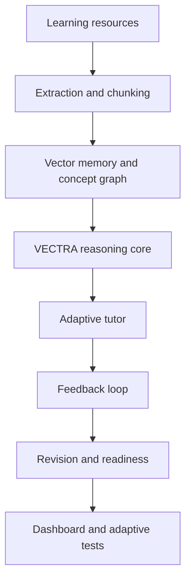

# VECTRA

VECTRA is a proposed Vector-Enhanced Cognitive Tutoring & Reasoning Architecture research framework; its analytics scores are transparent project metrics, not validated predictions of hiring outcomes.

## Run locally with Docker

```powershell
if (!(Test-Path .env)) { Copy-Item .env.example .env }
docker compose up --build
```

Open the app at `http://localhost:8080`. The API is served through `/api`; its local development docs are at `/docs`. The API port is also bound to `127.0.0.1:8000` for the Vite development server.

## Deploy

### Deploy the frontend to Vercel

Vercel hosts the Vite frontend. The FastAPI backend, PostgreSQL database, Redis queue, Celery indexing worker, and persistent upload storage must run on a separate host. The Docker Compose deployment below runs those services together. A frontend-only Vercel deployment will build and display the site, but API-backed features will not work until it can reach a deployed backend.

1. Import the `Honeymagam/VECTRA` GitHub repository into Vercel.
2. Set **Root Directory** to `frontend/project` and keep the framework preset as **Vite**.
3. Use `npm run build` as the build command and `dist` as the output directory. Vercel's SPA routing configuration is in `frontend/project/vercel.json`.
4. In the Vercel project settings, add `VITE_API_BASE_URL` for the Production and Preview environments. Set it to the public backend URL ending in `/api`, for example `https://api.example.com/api`, then redeploy. Do not put provider or database secrets in `VITE_` variables; those are included in the browser bundle.
5. Configure the backend's `CORS_ORIGINS` to include the Vercel production domain and any preview domains that need access.

The backend needs durable PostgreSQL storage with pgvector, Redis, a running Celery worker, and persistent storage for uploaded files. Keep large dataset uploads and indexing on that backend deployment; Vercel is serving the frontend only. The Vercel project should use `frontend/project` as its root so it does not try to build the Docker Compose stack.

### Deploy the full stack with Docker Compose

The Compose stack builds a static frontend image, applies Alembic migrations, and seeds the initial concepts and nine starter questions before the API starts. PostgreSQL data and uploaded-resource storage use persistent Docker volumes. Health checks gate the frontend on database and API readiness. Seeding is safe to repeat and does not overwrite user data.

```powershell
if (!(Test-Path .env)) { Copy-Item .env.example .env }
# Edit .env: set ENVIRONMENT=production and replace both example secrets.
docker compose up --build -d
```

Use unique alphanumeric `POSTGRES_PASSWORD` and unique `JWT_SECRET` values of at least 32 characters. Production startup rejects the template secrets and the default database password. To provision an administrator on first start, set `VECTRA_ADMIN_PASSWORD` in `.env`. To create an educator account, set `VECTRA_EDUCATOR_EMAIL` and `VECTRA_EDUCATOR_PASSWORD`; on restart, the configured email is promoted from student to educator if that account already exists. Educators can author concepts, relationships, questions and mock tests, and access the shared learning resources. Public registration always creates student accounts. Put a TLS reverse proxy in front of port 8080 for public deployment; the API is only published on the host loopback interface. Production disables interactive API documentation. Set `WEB_PORT` to change the frontend port.

To run the frontend in development mode instead, start the stack and then run `npm install` and `npm run dev` inside `frontend/project`. Vite proxies `/api` to the local backend. No Supabase credentials are needed.

The frontend supports account registration and sign-in, document uploads in PDF, DOCX, TXT and CSV formats, practice, tutor/search, and learning analytics through FastAPI. CSV files up to 5 GB are copied to the persistent uploads volume and indexed asynchronously in batches by the Celery worker; CSV headers and row values become searchable text chunks. PDF, DOCX and TXT uploads are limited to 20 MB. Redis queues indexing jobs. Set `MAX_UPLOAD_SIZE_MB` to adjust the CSV limit, and provision enough disk for the original file plus its indexed chunks and embeddings.

## Key API contract

All protected routes use `Authorization: Bearer <access_token>`. Register/login return access and refresh tokens. Admin-only routes are concept creation/relationships, question creation, and mock-test creation. Students can upload and delete their own documents; student data is always scoped to the authenticated user.

| Area | Endpoints |
|---|---|
| Auth | `POST /api/auth/register`, `/login`, `/refresh`; `GET /me` |
| Knowledge | `POST /api/documents/upload`, `GET/DELETE /api/documents/{id}`, `POST /api/search` |
| Learning | `/api/tutor/chat`, `/hint`, `/explain`, `/similar-question`; `/api/practice/*` |
| Intelligence | `/api/revision/*`, `/api/readiness*`, `/api/analytics/*` |
| Assessment | `/api/mock-tests`, `/{id}/start`, `/{id}/submit` |

`POST /api/search` body: `{"query":"percent increase", "top_k":5, "topic":"Percentages"}`. Tutor responses return retrieved source metadata. Embeddings use the OpenAI-compatible NVIDIA endpoint by default: set `EMBEDDING_API_KEY`, `EMBEDDING_BASE_URL=https://integrate.api.nvidia.com/v1`, `EMBEDDING_MODEL=nvidia/nemotron-3.5-embed-1b`, and `EMBEDDING_DIMENSIONS=2048`. VECTRA exposes `POST /v1/embeddings` locally and sends `input_type` (`query` or `passage`) and `truncate` to the provider. PostgreSQL stores vectors as pgvector `halfvec(2048)` so the HNSW cosine indexes support the model's native dimension.

## Model accuracy and retrieval evaluation

The **Model Accuracy** page shows measured benchmark reports; it does not display placeholder scores. Run the synthetic embedding retrieval evaluation from the project root with the configured embedding provider credentials:

```bash
python scripts/evaluate_tutor_benchmark.py
```

The default run sends 100 retrieval queries to the configured embedding provider and writes `data/generated/model_evaluation_latest.json`. For a real-data evaluation, run this after the labeled CSV uploads finish indexing:

```powershell
docker compose exec backend python scripts/evaluate_real_dataset.py
```

The real-data run samples up to 25 labeled question rows from each completed, non-synthetic CSV, evaluates tutor answer choices and retrieval against the uploaded answer keys and indexed source chunks, and writes `data/generated/model_evaluation_real_latest.json`. Both reports are mounted into the API so the page and landing page can display them. Real-data evaluation makes chat and embedding provider requests and may incur usage charges. To additionally measure tutor numeric exact-match accuracy on the synthetic set, run `python scripts/evaluate_tutor_benchmark.py --include-tutor`.

Reports measure embedding retrieval with Hit@5, Precision@5, MRR@5, and nDCG@5. The labeled real-data report also includes multiple-choice answer accuracy, class-level precision/recall/F1, and a 95% Wilson interval. Results are diagnostics: real dataset answer labels have not been independently expert-validated, and synthetic exact matching does not assess explanation quality or factuality.

## Architecture



## Testing

```bash
python -m pip install -r requirements-dev.txt
pytest
python -m alembic upgrade head
python scripts/seed.py
```
