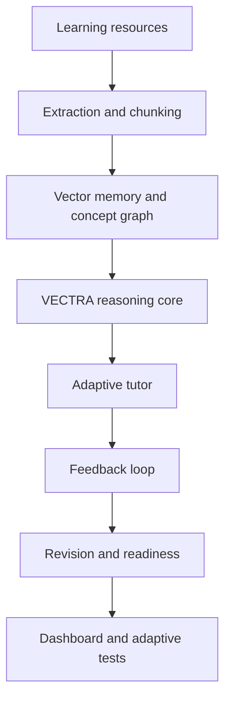

# VECTRA

VECTRA is a proposed Vector-Enhanced Cognitive Tutoring & Reasoning Architecture research framework; its analytics scores are transparent project metrics, not validated predictions of hiring outcomes.

## Run locally with Docker

```powershell
if (!(Test-Path .env)) { Copy-Item .env.example .env }
docker compose up --build
```

Open the app at `http://localhost:8080`. The API is served through `/api`; its local development docs are at `/docs`. The API port is also bound to `127.0.0.1:8000` for the Vite development server.

## Deploy

The Compose stack builds a static frontend image, applies Alembic migrations, and seeds the initial concepts and nine starter questions before the API starts. PostgreSQL data and uploaded-resource storage use persistent Docker volumes. Health checks gate the frontend on database and API readiness. Seeding is safe to repeat and does not overwrite user data.

```powershell
if (!(Test-Path .env)) { Copy-Item .env.example .env }
# Edit .env: set ENVIRONMENT=production and replace both example secrets.
docker compose up --build -d
```

Use unique alphanumeric `POSTGRES_PASSWORD` and unique `JWT_SECRET` values of at least 32 characters. Production startup rejects the template secrets and the default database password. To provision an administrator on first start, set `VECTRA_ADMIN_PASSWORD` in `.env`. To create an educator account, set `VECTRA_EDUCATOR_EMAIL` and `VECTRA_EDUCATOR_PASSWORD`; on restart, the configured email is promoted from student to educator if that account already exists. Educators can author concepts, relationships, questions and mock tests, and access the shared learning resources. Public registration always creates student accounts. Put a TLS reverse proxy in front of port 8080 for public deployment; the API is only published on the host loopback interface. Production disables interactive API documentation. Set `WEB_PORT` to change the frontend port.

To run the frontend in development mode instead, start the stack and then run `npm install` and `npm run dev` inside `frontend/project`. Vite proxies `/api` to the local backend. No Supabase credentials are needed.

The frontend supports account registration and sign-in, document uploads in PDF, DOCX, TXT and CSV formats, practice, tutor/search, and learning analytics through FastAPI. CSV files up to 5 GB are copied to the persistent uploads volume and indexed asynchronously in batches by the Celery worker; CSV headers and row values become searchable text chunks. PDF, DOCX and TXT uploads are limited to 20 MB. Redis queues indexing jobs. Set `MAX_UPLOAD_SIZE_MB` to adjust the CSV limit, and provision enough disk for the original file plus its indexed chunks and embeddings.

## Key API contract

All protected routes use `Authorization: Bearer <access_token>`. Register/login return access and refresh tokens. Admin-only routes are concept creation/relationships, question creation, and mock-test creation. Students can upload and delete their own documents; student data is always scoped to the authenticated user.

| Area | Endpoints |
|---|---|
| Auth | `POST /api/auth/register`, `/login`, `/refresh`; `GET /me` |
| Knowledge | `POST /api/documents/upload`, `GET/DELETE /api/documents/{id}`, `POST /api/search` |
| Learning | `/api/tutor/chat`, `/hint`, `/explain`, `/similar-question`; `/api/practice/*` |
| Intelligence | `/api/revision/*`, `/api/readiness*`, `/api/analytics/*` |
| Assessment | `/api/mock-tests`, `/{id}/start`, `/{id}/submit` |

`POST /api/search` body: `{"query":"percent increase", "top_k":5, "topic":"Percentages"}`. Tutor responses return retrieved source metadata. The local deterministic embedding provider is intended for development/testing; production PostgreSQL deployments should configure a provider implementation and migrate vector columns to pgvector `vector` types matching its dimensionality.

## Architecture



## Testing

```bash
python -m pip install -r requirements-dev.txt
pytest
python -m alembic upgrade head
python scripts/seed.py
```
